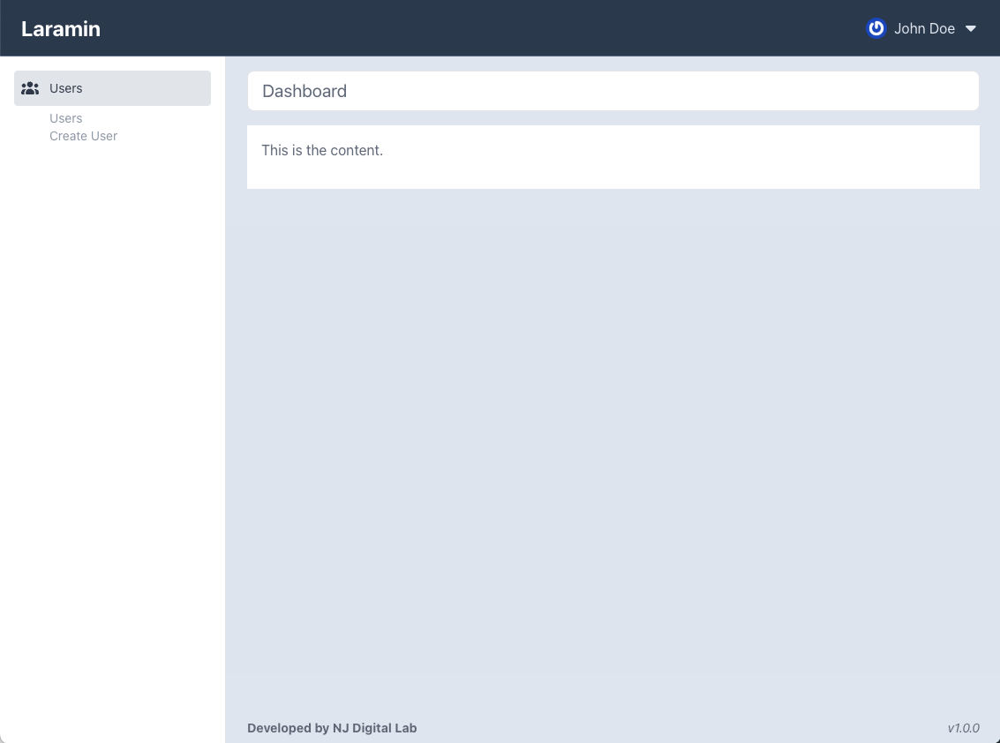

# Laramin

- [About](#About)
- [Installation](#Installation)
- [Getting Started](#Getting-Started)
- [Styling](#Styling)
- [Menu](#Menu)

## About

Laramin is a starter admin template for Laravel.



## Installation

Install with `composer require njdigitallab/laramin`.

Then run `php artisan laramin:install`.

The `laramin:install` command will put the necessary blade, css and js files in your Laravel's app resource path. From here on, you will be able to modify the files to your liking.

You can add `admin` as an argument to the `laramin:install` command, to put the files in an admin directory in each of the Laravel css, js and views directory.

## Getting Started

Open your blade file and add content as you normally will.

```html
@extends('layouts.app')

@section('title', 'Dashboard')

@section('page-title', 'Dashboard')

@section('content')
    This is the content.
@endsection
```

Open the `resources/css/app.css file` and import the sidebar.css file.

```css
@import 'tailwindcss';

@import './sidebar';
```

That's it! You now have a starter admin template to work with.

## Styling

While the markup is tailored towards tailwindcss, you can easily remove the classes from the blade files and add your own classes. You will have to reconfigure your app.css file to suit your setup.

## Menu

If the current url matches a menu item, it will automatically be marked as active. However, you may be on a page that does not have a url matching a menu item but you want to keep a parent menu open. To do this, add the following to your blade file.

```html
@section('header-js')
    var menuId = 'users';
@endsection
```

The `menuId` variable must be set to match menu id defined in the `sidebar` file.